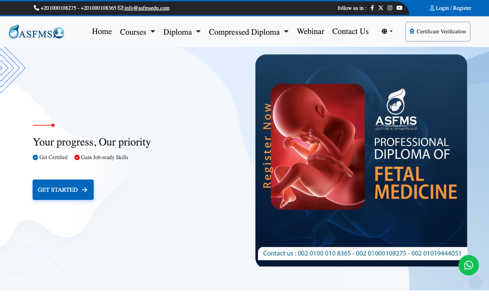
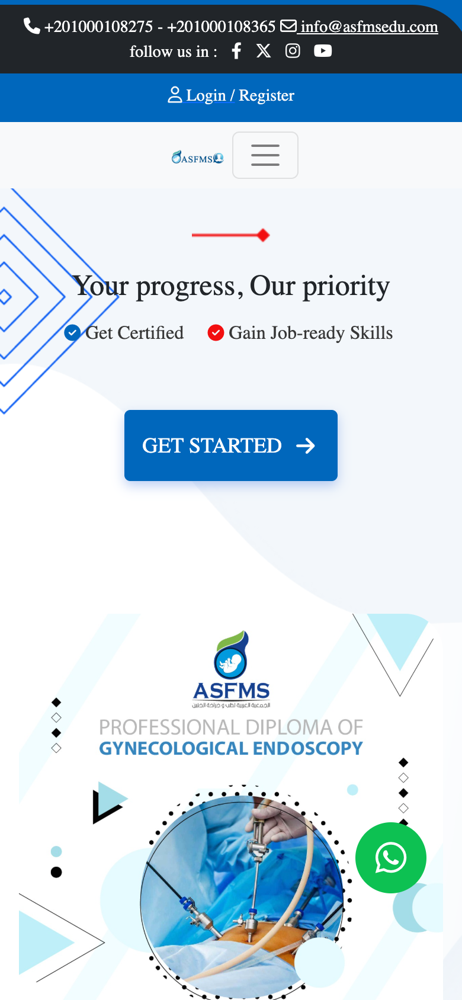
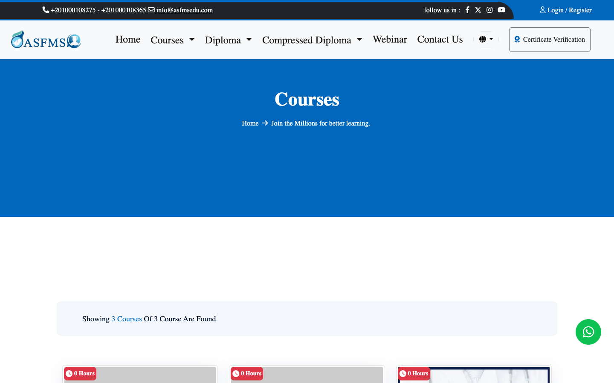
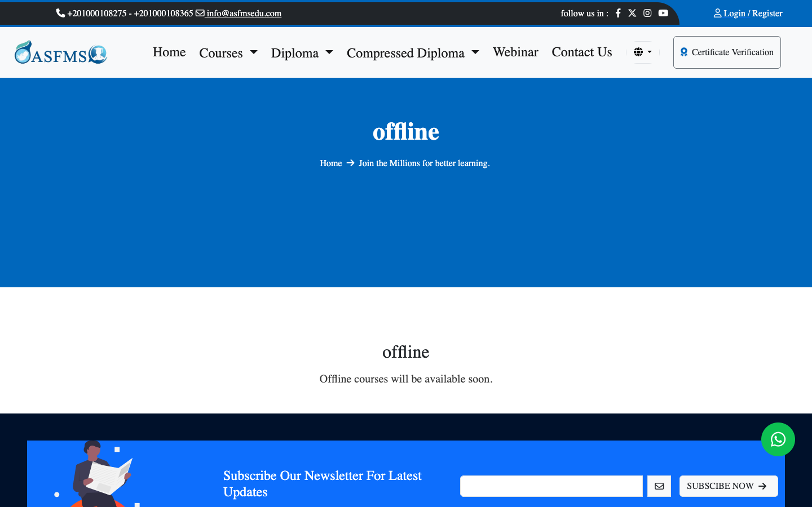
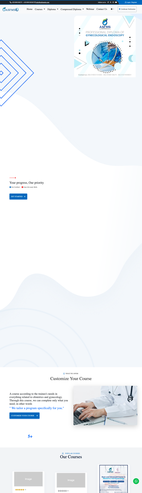

# ASFMSEDU

> Learning management system for medical education.

**Live:** [asfmsedu.com](https://asfmsedu.com/) · **Role:** CTO · **Period:** 2022 – 2026 · **For:** Brand Wizard

  

## Overview

An LMS for medical education: courses, learners and content delivery, with certificate verification.

## What it does

- Courses and learning content
- Learner accounts and progress
- Certificates with public verification
- Admin content management

## Engineering highlights

- Architecture and implementation led by me
- Focus on availability, security and scalability

## Screenshots (live site)

  
  
  

Full home page

---

Source code is private (client / commercial project). This repository documents the work only.

Built by **Ahmed Gamal** — Senior Laravel Developer · [LinkedIn](https://www.linkedin.com/in/wzcoder/) · [GitHub](https://github.com/ahmed-gamal-dev)
